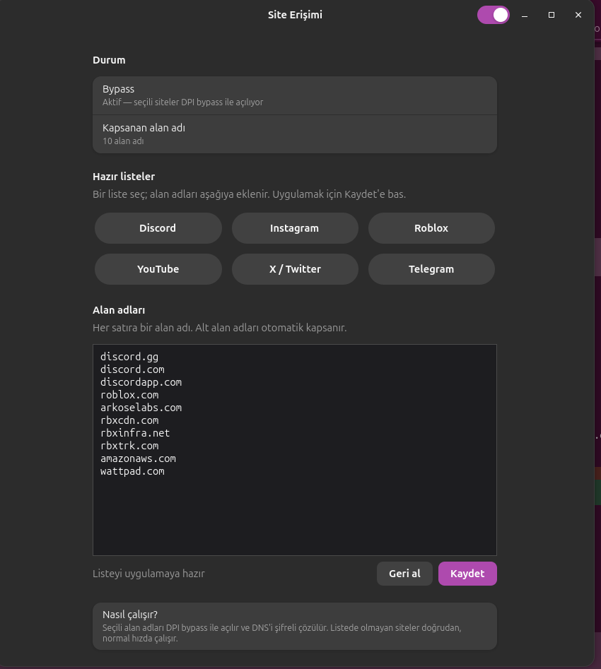

# Site Access

Some sites in Turkey are blocked with DPI. Discord is one of them: DNS returns a fake address, and connecting to the real IP still fails because the TLS handshake is cut on the SNI field. This app runs [zapret](https://github.com/bol-van/zapret) for the domains you pick and resolves those domains over Cloudflare DoT. Sites outside the list keep their normal connection.

Tested on Ubuntu 26.04, GNOME 50 and Wayland. Works on Debian and Ubuntu systems that use `systemd-resolved`.



## Features

- TCP 80 and 443 bypass for selected domains
- UDP 443, 3478, 19294-19344 and 50000-50100 for Discord voice
- Encrypted DNS only for the listed domains, everything else keeps the router DNS
- On/off switch, preset site lists, editable domain list
- Minimize or close the window to the system tray; reopen it by double-clicking the tray icon
- Quit from the tray menu while leaving the services running
- The last state survives a reboot

## Install

You need root, an internet connection and apt.

```bash
git clone https://github.com/anilsoylu/zapret-sites-gui.git
cd zapret-sites-gui
sudo ./install.sh
```

The script installs dependencies, downloads zapret v72.13, builds it under `/opt/zapret`, and installs the services and the GUI. It adds a "Site Erişimi" entry to the application menu.

Start it with:

```bash
zapret-sites-gui
```

## Usage

The switch in the header turns the bypass on and off. When it is on, the `zapret` and `zapret-dns` services start and are enabled at boot. When it is off, both stop and are removed from boot.

The preset buttons append domains for Discord, Instagram, Roblox, YouTube, X and Telegram to the text box. You can also type domains by hand, one per line. Subdomains are covered by their parent domain. Press **Save** to apply changes; the services restart.

Closing or minimizing the window hides it in the system tray. Double-click the tray icon to reopen it, or right-click the icon to open the menu. Quitting the app does not stop the bypass; use the switch to turn it off.

## How it works

zapret's `nfqws` sends packets for the selected domains through a netfilter queue and splits the TLS ClientHello into two packets. The DPI device cannot see the SNI field in a single packet, so it cannot block the connection. `MODE_FILTER=hostlist` limits this to the domains in `/opt/zapret/ipset/zapret-hosts-user.txt`.

For DNS, the app creates a dummy interface named `zapretdns` (`10.53.53.1/32`), assigns Cloudflare DoT servers to it with `resolvectl`, and routes only the listed domains to that interface. Other domains use the system resolver, so this is split DNS. A drop-in restarts the DNS service when `systemd-resolved` restarts, re-applying the setup.

Installed files:

| Path | Contents |
| --- | --- |
| `/opt/zapret` | zapret source and built binaries |
| `/opt/zapret/ipset/zapret-hosts-user.txt` | Covered domains |
| `/usr/local/bin/zapret-sites-gui` | GTK4 interface |
| `/usr/local/libexec/zapret-sites-tray` | GTK3 Ayatana tray indicator and menu |
| `/usr/local/libexec/zapret-gui-helper` | Narrow root helper |
| `/usr/local/sbin/zapret-dns-setup.sh` | Split DNS setup |
| `/usr/local/sbin/zapret-dns-teardown.sh` | Removes the dummy interface |
| `/etc/systemd/system/zapret.service` | Bypass service |
| `/etc/systemd/system/zapret-dns.service` | DNS service |
| `/etc/systemd/system/systemd-resolved.service.d/zapret-dns-upholds.conf` | Drop-in that re-runs the DNS setup when `systemd-resolved` restarts |
| `/etc/sudoers.d/zapret-gui` | NOPASSWD rule for the helper |

The GUI does not run as root. It calls the helper through `sudo`, and the helper accepts only `status`, `on`, `off` and `set-list`. The sudoers rule allows one command from one file.

## Strategy

The strategy was found with `blockcheck.sh` on a Superonline line:

```text
TCP 443: --dpi-desync=multisplit --dpi-desync-split-pos=2
TCP 80:  --dpi-desync=multisplit --dpi-desync-split-pos=method+2
UDP:     --dpi-desync=fake --dpi-desync-repeats=6 --filter-l7=discord,stun
```

If it does not work on another ISP, run `/opt/zapret/blockcheck.sh` and put the result into `NFQWS_OPT` in `/opt/zapret/config`.

## Speed

On a 50 MB Cloudflare download I measured 31-34 MB/s with the bypass on and 33-35 MB/s with it off. The difference is around 3%. `nfqws` uses no CPU when idle and only processes packets that reach the queue.

## Limits

- It does not help with sites blocked at the IP level, such as Roblox. The bypass defeats SNI-based DPI, not an IP block.
- It only affects the machine it is installed on, not a whole network.
- `DISABLE_IPV6=1` is set. The nfqws rules cover IPv4; IPv6 traffic is not bypassed.
- The services run as root. Installing and removing needs `sudo`.

## Uninstall

```bash
sudo ./uninstall.sh
```

This stops the services and removes the installed files and the sudoers rule. To delete the zapret source as well:

```bash
sudo ./uninstall.sh --purge
```

## License

MIT. See [LICENSE](LICENSE).
